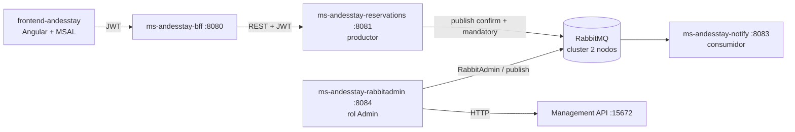
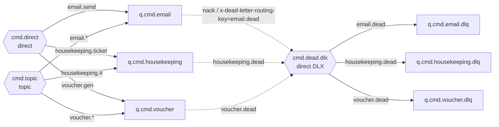
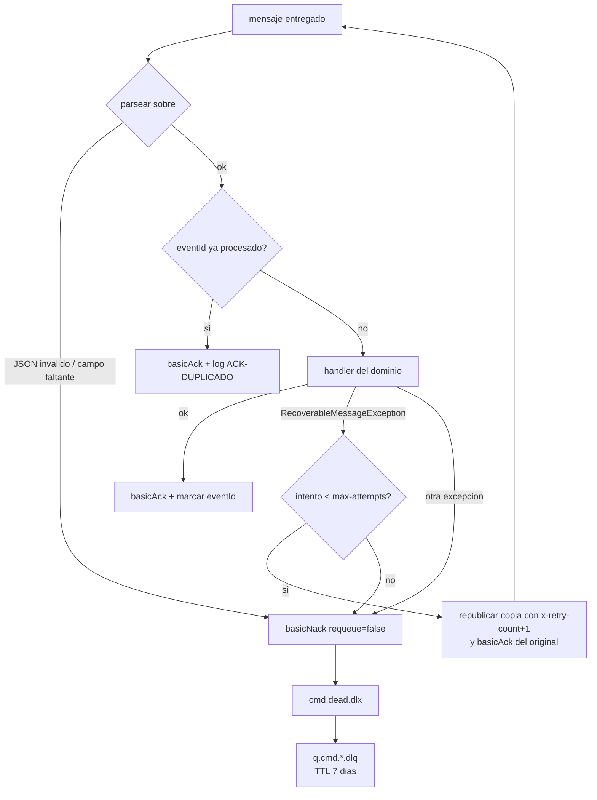

# Arquitectura de mensajeria AndesStay (EP3)

## Vista general



- **reservations** publica comandos cuando una reserva cambia de estado. El dominio (`ReservationService`) solo conoce la interfaz `ReservationNotificationPublisher`; la implementacion con `RabbitTemplate` vive en el paquete `messaging`.
- **notify** consume con ACK manual y simula envio de emails, tickets de housekeeping y PDFs.
- **rabbitadmin** administra colas, exchanges y bindings, y publica mensajes de prueba.

## Topologia

Todos los exchanges y colas son **durables**. Los nombres salen de `andesstay.messaging.*` (application.yaml) y se declaran en `RabbitTopologyConfig` (reservations y notify declaran la misma topologia; declarar es idempotente).



| Cola | Argumentos | Bindings |
|---|---|---|
| `q.cmd.email` | `x-dead-letter-exchange=cmd.dead.dlx`, `x-dead-letter-routing-key=email.dead` | `cmd.direct`/`email.send`, `cmd.topic`/`email.*` |
| `q.cmd.housekeeping` | DLX + `housekeeping.dead` | `cmd.direct`/`housekeeping.ticket`, `cmd.topic`/`housekeeping.#` |
| `q.cmd.voucher` | DLX + `voucher.dead` | `cmd.direct`/`voucher.gen`, `cmd.topic`/`voucher.*` |
| `q.cmd.email.dlq` | `x-message-ttl=604800000` (7 dias) | `cmd.dead.dlx`/`email.dead` |
| `q.cmd.housekeeping.dlq` | `x-message-ttl` 7 dias | `cmd.dead.dlx`/`housekeeping.dead` |
| `q.cmd.voucher.dlq` | `x-message-ttl` 7 dias | `cmd.dead.dlx`/`voucher.dead` |

Total: 3 exchanges, 6 colas y 9 bindings.

### Por que direct y topic

- `cmd.direct`: match exacto. Lo usan los comandos con un destino unico y conocido (`email.send`, `voucher.gen`).
- `cmd.topic`: match por patron. Housekeeping publica `housekeeping.ticket.preparacion` y `housekeeping.ticket.limpieza`, y ambos calzan con `housekeeping.#`. Se pueden agregar nuevos tipos de ticket sin tocar bindings.

## Comandos por cambio de estado

| Estado nuevo | Comandos | Ruta |
|---|---|---|
| CREADA | email | `cmd.direct` -> `email.send` |
| CONFIRMADA | email + voucher + ticket preparacion | `email.send`, `voucher.gen` (direct) + `housekeeping.ticket.preparacion` (topic) |
| CHECKIN_PENDIENTE | email recordatorio | `email.send` |
| EN_ESTADIA | (ninguno) | |
| CHECKOUT | email + ticket limpieza + boleta | `email.send`, `voucher.gen` (direct) + `housekeeping.ticket.limpieza` (topic) |
| CANCELADA | email | `email.send` |

## Contrato de mensaje (envelope)

```json
{
  "type": "VOUCHER_GENERAR",
  "eventId": "2f1c9a8e-6a43-4c55-9d0a-7d2f9e0b1c11",
  "timestamp": "2026-10-18T21:47:07.646Z",
  "traceId": "8751e1b0-aa2f-4a5f-9882-fb3c6abd25d9",
  "correlationId": "reservation-10",
  "source": "ms-andesstay-reservations",
  "payload": { "reservationId": 10, "clienteUsername": "ana@andesstay.cl", "alojamientoNombre": "Cabana Volcan",
               "fechaInicio": "2026-12-01", "fechaFin": "2026-12-05", "precioTotal": 250000.0,
               "estado": "CONFIRMADA", "estadoAnterior": "CREADA" }
}
```

Propiedades AMQP: `delivery_mode=2` (persistente), `content_type=application/json`, `message_id=eventId`, `correlation_id`, `type`, `app_id=source` y header `x-trace-id`.

## Garantias del productor (reservations)

- **Publisher confirms (correlated):** cada envio lleva `CorrelationData(eventId)`; el broker responde ack/nack y se loguea `[CONFIRM]`.
- **Publisher returns + mandatory=true:** si ninguna cola calza con la routing key, el broker devuelve el mensaje (`[RETURN]`) en vez de descartarlo.
- **Broker caido:** `try/catch` en el adaptador. La reserva ya se guardo y se loguea `[PUBLISH-FAIL]` (warn); la operacion HTTP responde normalmente.

## Estrategia ACK / NACK / DLQ (notify)

`acknowledge-mode: manual`, `prefetch: 5` (configurable con `NOTIFY_PREFETCH`) y `default-requeue-rejected: false`.



| Situacion | Clasificacion | Accion |
|---|---|---|
| Procesado OK | exito | `basicAck` |
| `eventId` repetido | duplicado | `basicAck` + `log.warn`, sin reprocesar |
| JSON mal formado, `eventId` no UUID, campo obligatorio faltante | no recuperable | `basicNack(requeue=false)` -> DLQ + `log.error(eventId, cola, motivo)` |
| Fallo transitorio (`RecoverableMessageException`) | recuperable | republicar copia con `x-retry-count+1` (default exchange -> misma cola) tras un backoff, y `basicAck` del original |
| Fallo transitorio en el intento `max-attempts` (3) | intentos agotados | `basicNack(requeue=false)` -> DLQ |
| Cualquier otra excepcion | inesperado | se trata como no recuperable |

**Por que no `requeue=true`:** un mensaje que siempre falla volveria a la cabeza de la cola sin fin (poison message), consumiendo CPU y bloqueando a los demas. El contador `x-retry-count` viaja en el propio mensaje, asi el limite se respeta aunque el consumidor se reinicie.

**Idempotencia:** RabbitMQ entrega *at-least-once*. Si notify procesa y se cae antes del ACK, el mensaje se re-entrega. `ProcessedEventRegistry` recuerda los `eventId` procesados (LRU en memoria, 10.000 entradas); en produccion iria en Redis o en una tabla con clave unica.

**DLQ:** las DLQ retienen los mensajes 7 dias (`x-message-ttl`, configurable con `ANDESSTAY_DLQ_RETENTION`). RabbitMQ agrega el header `x-death` (reason `rejected`, cola, exchange y routing keys de origen, count). El `DeadLetterListener` esta apagado por defecto para que los mensajes queden visibles en la Management UI; con `NOTIFY_DLQ_LISTENER=true` los loguea y hace ACK.

## Cluster

`infra/compose.yml` levanta `rabbit1` (5672/15672) y `rabbit2` (5673/15673) con la misma Erlang cookie y peer discovery `classic_config`. Los microservicios usan `spring.rabbitmq.addresses` (por ejemplo `localhost:5672,localhost:5673`): si un nodo cae, el cliente se reconecta al otro.

**Limitacion conocida:** las colas son *classic*, asi que cada una vive en un nodo (exchanges y bindings si se replican). Para que una cola sobreviva la caida de su nodo habria que usar *quorum queues*, que requieren al menos 3 nodos para tolerar una falla. Queda como mejora de la etapa siguiente.
