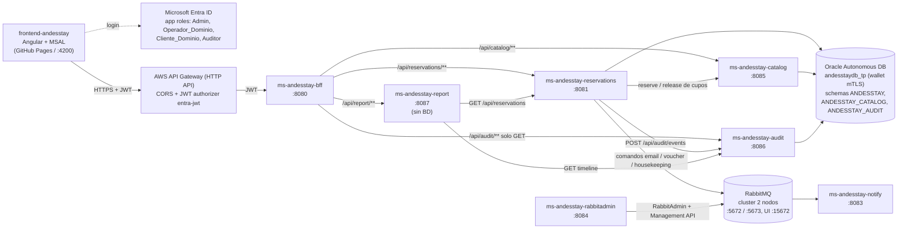

# Arquitectura AndesStay: servicios y puertos

Vista completa de los servicios. El detalle de la topologia RabbitMQ (exchanges, colas, DLQ, ACK/NACK) esta en [arquitectura-mensajeria.md](arquitectura-mensajeria.md).

- Todas las llamadas entre microservicios son **REST sincronico** con el JWT del usuario propagado (`Authorization: Bearer ...`); cada servicio vuelve a validar el token y aplica sus `@PreAuthorize`.
- RabbitMQ solo transporta los **comandos** de reservations hacia notify (email, voucher, housekeeping). Catalog, audit y report no usan RabbitMQ.
- Cada servicio con BD usa su propio schema en la misma Oracle ADB (`DB_USERNAME`), con la misma `DB_URL` (alias `andesstaydb_tp` + wallet).

## Puertos y dependencias

| Servicio | Puerto | Persistencia | Llama a | Variables de entorno |
|---|---|---|---|---|
| frontend-andesstay | 4200 (dev) | - | API Gateway | - |
| AWS API Gateway | 443 | - | bff | - |
| ms-andesstay-bff | 8080 | - | reservations, catalog, audit, report | `RESERVATIONS_URL`, `CATALOG_URL`, `AUDIT_URL`, `REPORT_URL` |
| ms-andesstay-reservations | 8081 | Oracle `ANDESSTAY` | catalog, audit, RabbitMQ | `DB_URL`, `DB_USERNAME`, `DB_PASSWORD`, `CATALOG_URL`, `AUDIT_URL`, `RABBITMQ_*` |
| ms-andesstay-notify | 8083 | - | RabbitMQ | `RABBITMQ_*` |
| ms-andesstay-rabbitadmin | 8084 | - | RabbitMQ (AMQP + Management API) | `RABBITMQ_*` |
| ms-andesstay-catalog | 8085 | Oracle `ANDESSTAY_CATALOG` | - | `DB_URL`, `DB_USERNAME`, `DB_PASSWORD` |
| ms-andesstay-audit | 8086 | Oracle `ANDESSTAY_AUDIT` | - | `DB_URL`, `DB_USERNAME`, `DB_PASSWORD` |
| ms-andesstay-report | 8087 | - (KPIs al momento) | reservations, audit | `RESERVATIONS_URL`, `AUDIT_URL` |
| RabbitMQ | 5672, 5673 (AMQP), 15672 (UI) | volumenes Docker | - | ver `mq/compose.yml` |
| Oracle Autonomous DB | 1522 (mTLS) | OCI Always Free | - | wallet en `C:/oracle/wallet_andesstay` |

En Docker, las URLs usan el nombre del contenedor, por ejemplo `CATALOG_URL=http://ms-andesstay-catalog:8085`.

## Flujos principales

| Flujo | Recorrido | Si falla una dependencia |
|---|---|---|
| Crear reserva | bff -> reservations -> Oracle; audit `RESERVA_CREADA`; RabbitMQ `EMAIL_RESERVA_CREADA` | audit o RabbitMQ caidos: `log.warn`, la reserva se crea igual |
| Confirmar reserva con `unidadId` | bff -> reservations -> catalog `reserve` -> Oracle; audit `CAMBIO_ESTADO`; RabbitMQ email + voucher + housekeeping | sin cupos: **409**; catalog caido: **503**; audit/RabbitMQ caidos: `log.warn` |
| Cancelar / checkout | bff -> reservations -> Oracle; catalog `release`; audit; RabbitMQ | catalog, audit o RabbitMQ caidos: `log.warn`, el cambio se guarda |
| Timeline de una reserva | bff -> audit | audit caido: **503** desde el BFF |
| KPIs | bff -> report -> reservations + audit | reservations caido: **503**; audit caido: `tiempoCicloPromedioHoras = null` con aviso |
| Catalogo | bff -> catalog -> Oracle | BD caida: **503** |

## Roles por servicio

| Servicio | Admin | Operador_Dominio | Cliente_Dominio | Auditor |
|---|---|---|---|---|
| reservations | todo | lee, crea, actualiza, cambia estado | lee/crea/actualiza solo las suyas | lee |
| catalog | todo | lee, reserve/release | lee | lee |
| audit | lee, registra | registra | registra | lee |
| report | lee | - | - | - |
| rabbitadmin | todo | - | - | - |

El registro en audit (`POST /api/audit/events`) solo lo hace reservations, con el JWT del usuario que hizo la accion, y no se expone en el BFF.
